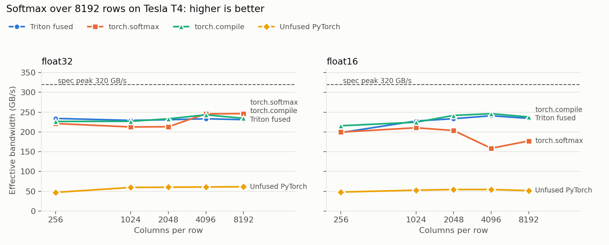

# Fused Softmax in Triton

A row wise softmax written as a single fused GPU kernel in [Triton](https://github.com/triton-lang/triton), benchmarked against unfused PyTorch, `torch.softmax`, and `torch.compile` on an NVIDIA T4.



## Why fuse softmax

Softmax does very little math per byte, so it is **memory bound**: runtime is set by how many bytes move between GPU memory (DRAM) and the cores, not by FLOPs.

Written as plain PyTorch ops, softmax launches five separate kernels (max, subtract, exp, sum, divide). Each one reads its input from DRAM and writes its output back, which adds up to about **5 full reads and 3 full writes** of the tensor.

The fused kernel assigns one Triton program to each row. The program loads the row into registers once, then computes the max, exp, sum and divide on chip and writes the result once. That's **1 read and 1 write**, the minimum possible, so the best achievable speedup over the unfused version is roughly 4x.

Implementation details:
- **Numerical stability:** subtracts the row max before `exp`, and a large value test checks that no output is `inf` or `nan`.
- **Non power of two widths:** lanes past the row end load `-inf`, so they contribute `exp(-inf) = 0` to the sum.
- **FP16 inputs:** values are cast up and accumulated in FP32, then cast back on store.
- **Warp count:** scales with row width (4, 8 or 16 warps) so wide rows don't spill registers to local memory.

## Results

**GPU:** Tesla T4 (320 GB/s spec peak) · 8192 rows · torch 2.11.0+cu130 · triton 3.6.0 · median of `do_bench`

| dtype | cols | naive (ms) | torch.compile (ms) | torch.softmax (ms) | Triton fused (ms) | Triton GB/s | % of peak | vs naive | vs torch.softmax |
|---|---:|---:|---:|---:|---:|---:|---:|---:|---:|
| float32 | 256 | 0.356 | 0.074 | 0.076 | 0.072 | 234 | 73% | 4.97x | 1.06x |
| float32 | 1024 | 1.126 | 0.296 | 0.316 | 0.293 | 229 | 72% | 3.85x | 1.08x |
| float32 | 2048 | 2.231 | 0.576 | 0.630 | 0.582 | 231 | 72% | 3.84x | 1.08x |
| float32 | 4096 | 4.422 | 1.104 | 1.093 | 1.151 | 233 | 73% | 3.84x | 0.95x |
| float32 | 8192 | 8.753 | 2.290 | 2.181 | 2.324 | 231 | 72% | 3.77x | 0.94x |
| float16 | 256 | 0.175 | 0.039 | 0.042 | 0.042 | 198 | 62% | 4.14x | 0.99x |
| float16 | 1024 | 0.637 | 0.150 | 0.159 | 0.147 | 228 | 71% | 4.32x | 1.08x |
| float16 | 2048 | 1.235 | 0.278 | 0.330 | 0.288 | 233 | 73% | 4.29x | 1.15x |
| float16 | 4096 | 2.470 | 0.545 | 0.846 | 0.557 | 241 | 75% | 4.43x | 1.52x |
| float16 | 8192 | 5.205 | 1.129 | 1.516 | 1.146 | 234 | 73% | 4.54x | 1.32x |

Correctness: max absolute error against an FP32 reference was 1.5e-8 for FP32 and 8.6e-5 for FP16.

### What the numbers show

- **Fusion delivers what the memory traffic predicts.** The unfused version moves about 8 tensor passes through DRAM, and the fused kernel moves 2. The measured speedup is 3.8x to 4.5x for rows of 1024 columns and wider. At 256 columns it reaches about 5x, likely because the five extra kernel launches also start to show up in the timing.
- **The kernel sustains 72 to 75% of the T4's peak DRAM bandwidth** across most shapes. The exception is short FP16 rows (256 columns), at 62%. There each program has only 512 bytes to load, which isn't enough work to hide memory latency.
- **FP32: on par with PyTorch's hand written kernel** (0.94x to 1.08x).
- **FP16: up to 1.52x faster than `torch.softmax`** at 4096 columns and above. In this range `torch.softmax` drops to about 160 GB/s, while the Triton kernel holds about 240 GB/s.
- **`torch.compile` lands within about 8% of the hand written kernel.** That's expected, since Inductor generates a fused Triton kernel for softmax too. It shows that the remaining performance comes from fusion itself, not from tricks specific to this kernel.

**Effective bandwidth** is the ideal traffic (1 read + 1 write of the tensor) divided by runtime, so it's directly comparable to the GPU's spec peak. All timings are medians from `triton.testing.do_bench`, and every implementation is checked against an FP32 reference before it's timed.

## Run it

**On a GPU (free Colab T4):** open `triton_softmax_gpu_benchmark.ipynb` in Colab, set Runtime > Change runtime type > T4 GPU, then choose Run all.

**Correctness check on CPU, no GPU needed:**

```bash
TRITON_INTERPRET=1 python triton_softmax.py
```

## Files

| File | Purpose |
|---|---|
| `triton_softmax.py` | Kernel, correctness checks, benchmark; writes `gpu_results.json` and `results.md` |
| `plot_results.py` | Bandwidth chart (`softmax_bandwidth.png`) |
| `triton_softmax_gpu_benchmark.ipynb` | One click Colab runner |
